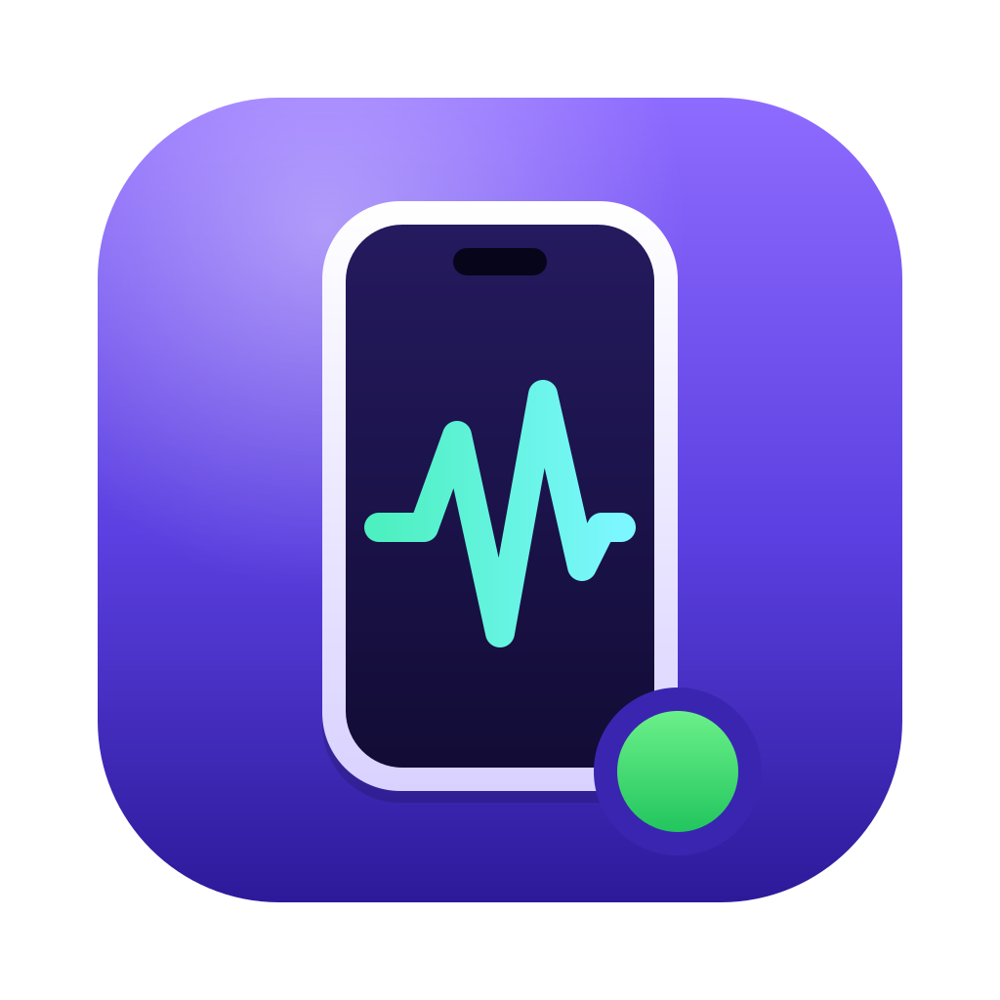
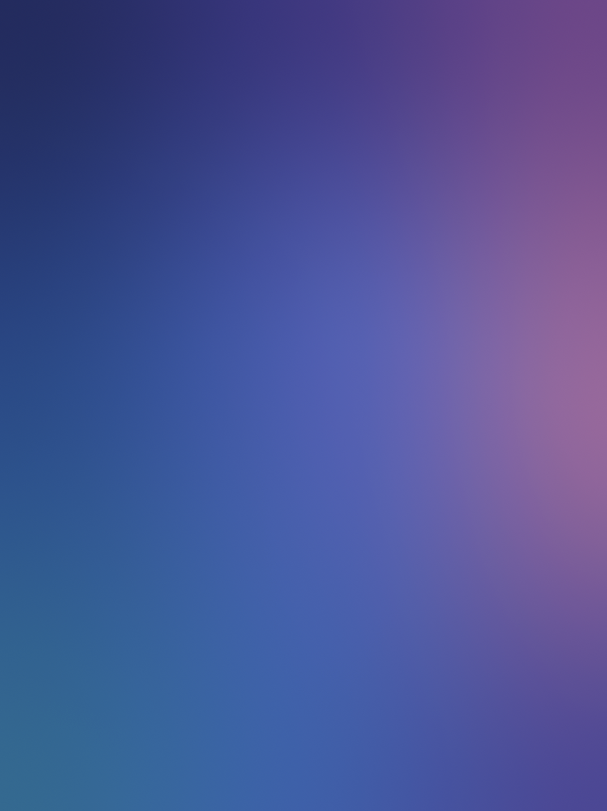
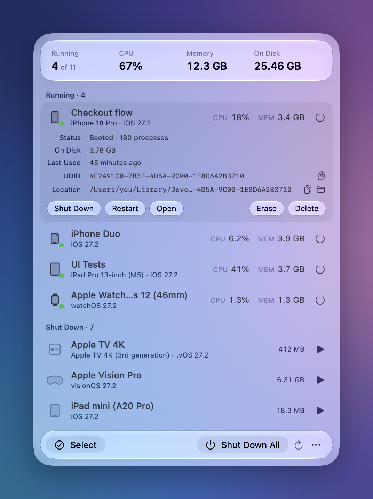
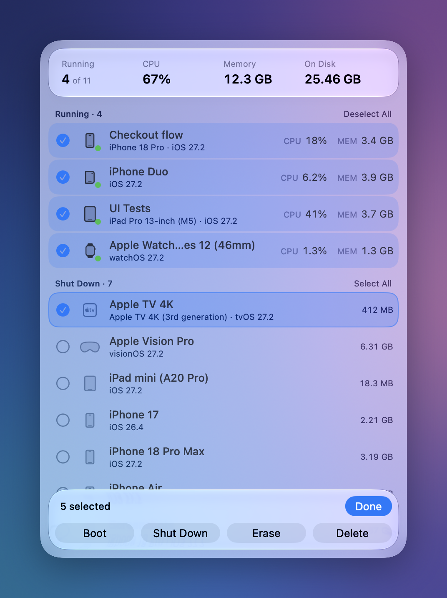

<p align="center">
  
</p>

<h1 align="center">Sim Monitor</h1>

<p align="center">
  A menu bar app for watching and managing your Xcode simulators.
</p>

<p align="center">
  
</p>

Simulators pile up. They keep running after you forget about them, each one holding
gigabytes of memory, and old ones sit on disk long after the project is done. Sim Monitor
puts all of them one click away in the menu bar: what is running, what it costs, where it
lives, and the buttons to boot, stop, wipe or remove it.

## Features

- **Live count in the menu bar.** The icon shows how many simulators are booted.
- **Resource use per simulator.** CPU and memory for every running device, plus totals.
- **Every simulator on the machine.** Booted or shut down, with runtime, disk size, UDID
  and location.
- **One-click actions.** Boot, shut down, restart, erase, delete, open in Simulator, show
  in Finder.
- **Multi-select.** Pick several simulators and boot, shut down, erase or delete them
  together.
- **Keyboard driven.** Arrow keys move through the list; everything else is a key away.
- **Native.** SwiftUI with Liquid Glass, no Dock icon, no dependencies.

## Requirements

- macOS 26 or later
- Xcode, with its command line tools selected (`xcode-select -p` should print a path)

## Install

```sh
git clone git@github.com:flexaargo/sim-monitor.git
cd sim-monitor
./scripts/build-app.sh --install
```

This builds `SimMonitor.app`, copies it to `/Applications` and launches it. A phone icon
appears in the menu bar. Leave off `--install` to only build into `build/`.

To start it automatically, open the popover, click **•••** and turn on **Launch at Login**.

## Usage

### The menu bar item

Click the phone icon to open the popover. When simulators are running the icon shows
radio waves and the number that are booted, so you can tell at a glance without opening
anything.

### Reading the list

The header shows totals across all simulators: how many are running, their combined CPU
and memory, and how much disk every simulator takes together.

Below it, simulators are grouped into **Running** and **Shut Down**:

- Running rows show live **CPU** and **MEM**, refreshed every two seconds while the
  popover is open.
- Shut-down rows show how much disk the simulator uses.
- A simulator whose runtime is no longer installed is marked **Unavailable**. It can't be
  booted, only deleted.

The button at the end of each row is the quick action: **⏻** shuts a running simulator
down, **▶** boots a stopped one.

### Details and actions

<p align="center">
  
</p>

Click a row to expand it. You get its status and process count, disk use, when it was last
used, its UDID and its location on disk. The icons beside the UDID and location copy them;
the folder icon reveals the simulator in Finder.

| Action | What it does |
| --- | --- |
| **Boot** | Starts the simulator headless. It runs without a window until you open it. |
| **Shut Down** | Stops the simulator and frees its memory. |
| **Restart** | Shuts down, then boots again. |
| **Open** | Shows the device in the Simulator app, booting it first if needed. |
| **Erase** | Removes all apps, data and settings. The simulator itself is kept, and is booted again afterwards if it was running. |
| **Delete** | Removes the simulator and everything on it. This can't be undone. |

Erase and Delete ask for confirmation in place before doing anything. The same actions are
available by right-clicking a row.

### Working with several at once

<p align="center">
  
</p>

Click **Select** to enter selection mode, then click rows to tick them. **Select All**
on a section header ticks that whole group, which makes "shut down everything running" or
"delete everything that's stopped" two clicks.

The bar at the bottom acts on the selection. Each button only applies to the simulators it
makes sense for: with a mixed selection, **Boot** starts the stopped ones and **Shut
Down** stops the running ones. Erase and Delete confirm first and tell you how many
simulators they'll affect. Click **Done** or press Esc to leave selection mode.

**Shut Down All** in the normal bar stops every running simulator without selecting
anything.

### Keyboard

| Key | Action |
| --- | --- |
| ↑ ↓ | Move the highlight |
| ⇧↑ ⇧↓ | Extend the selection, entering selection mode |
| Space or Return | Expand the highlighted row, or tick it in selection mode |
| → ← | Expand or collapse the highlighted row |
| ⌘A | Select all |
| Esc | Leave selection mode, or collapse the open row |
| ⌘Q | Quit |

### The ••• menu

- **Delete Unavailable Simulators** removes every simulator whose runtime is gone.
- **Launch at Login** starts Sim Monitor when you log in.
- **Quit Sim Monitor**

## About the numbers

- **Memory** is the sum of the physical footprint of every process inside the simulator,
  the same figure Activity Monitor shows in its Memory column. A freshly booted iOS
  simulator runs a couple of hundred processes, so several gigabytes each is normal. The
  total can exceed your installed RAM because macOS compresses and swaps memory.
- **CPU** is the percentage of one core, like Activity Monitor, so a busy simulator can
  read above 100%.
- **On Disk** is the size of the simulator's data directory as reported by `simctl`.

## How it works

Sim Monitor has two sources of information:

- `xcrun simctl list -j` for the simulators themselves, and `simctl` for every action.
- The process table, read directly through `libproc`, for resource use. Each booted
  simulator has a `launchd_sim` process whose arguments name the device, and everything
  running inside the simulator is a descendant of it.

Reading the process table is cheap, so it doubles as the change detector: `simctl` only
runs again when a simulator appears or disappears, or the list has gone stale.

```
Sources/
  SimMonitorCore/     simctl wrapper, models, process sampler (no UI)
  SimMonitor/         SwiftUI menu bar app
Tests/
  SimMonitorCoreTests/
scripts/
  build-app.sh        builds and optionally installs SimMonitor.app
  screenshots.sh      regenerates the images in this README
```

## Development

```sh
swift run SimMonitor        # run without bundling
swift test                  # run the tests
./scripts/screenshots.sh    # regenerate docs/images from sample data
```

One test drives the real `simctl`: it creates its own simulator, boots it, checks the
resource sampling, then shuts it down, erases and deletes it. It never touches simulators
that already exist.

`screenshots.sh` needs Screen Recording permission for the terminal you run it from. It
uses sample data, so nothing from your machine ends up in the images.

## Troubleshooting

- **The list is empty or shows an error.** Sim Monitor shells out to `xcrun simctl`. Check
  that `xcrun simctl list` works in a terminal; if it doesn't, run
  `sudo xcode-select -s /Applications/Xcode.app`.
- **Launch at Login is missing.** It only appears when running the bundled app, not under
  `swift run`.
- **Memory looks too high.** See [About the numbers](#about-the-numbers).
